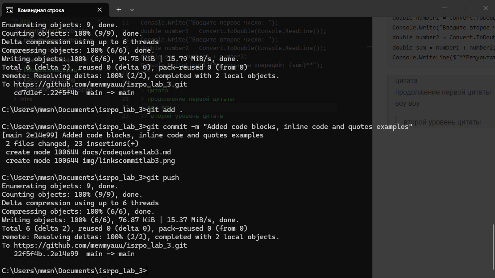

# Лабораторная работа 3
---
цель лабораторной изучить язык разметки markdown[^markdown]. множество заданий нацелено на выполнения практических задач связанных с markdown и laatex. лабораторная выполнена добросовестно и честно.
## Мой прогресс выполнения

### Содержание:
- [advancedmarkdownlab3.md](/docs/advancedmarkdownlab3.md)
- [codequoteslab3.md](/docs/codequoteslab3.md)
- [formattinglab3.md](/docs/formattinglab3.md)
- [headerslab3.md](/docs/headerslab3.md)
- [kommentcs.md](/docs/kommentcs.md)
- [latexlab3.md](/docs/latexlab3.md)
- [linksimageslab3.md](/docs/linksimageslab3.md)
- [listslab3.md](/docs/listslab3.md)
- [readmepushlab3.md](/docs/readmepushlab3.md)
- [separatorslab3.md](/docs/separatorslab3.md)
- [tableslab3.md](/docs/tableslab3.md)

#### 3. форматирование текста
* **полужирный**
* *курсив*
* ~~зачеркнутый~~
* `моноширный`

#### 4. списки
* маркированный
1. нумерованный
- первый вложенный
    1. нумерованный
- второй вложенный
    * маркированный

#### 5. цитата
> Ну вот и всё… Неплохая получилась история. Интересная, весёлая, порой немного грустная, а главное – поучительная. Она научила нас быть смелыми и не бояться перемен…

#### 6. блок кода
```python
a = 5
b = 5
sum = a + b
print(sum) 
```

#### 7. таблица

| Функция | Команда git | Описание |
|----------|-----------| -----------|
| Создание репозитория | **git init** |  Инициализация репозитория |
| Просмотр состояния | **git status** |  Показывает изменённые файлы |
| Отправка на github | **git push** |  Загружает коммиты на сервер |

#### 8. изображение из папки `/img`


#### 9. ссылка
1. Внутренняя: [advancedmarkdownlab3.md](/docs/advancedmarkdownlab3.md)
2. Внешняя: [markdown](https://markdownguide.org/ "перейти на официальный сайт")

#### 10. чекбоксы
- [x] выполнил лабораторную
- [ ] пошел на пару

#### 11. сноска
я хочу пиццы[^pizza]

### 12. alert-блоки
> [!NOTE] ЗАПИСКА 
> hello world

> [!TIP] СОВЕТИК
> hello world

> [!WARNING] ПРЕДУПРЕЖДЕНИЕ
> hello world

#### 13. inline latex
$s = \pi \cdot r^2$

#### 14. block latex
$$
\sum_{i=1}^n i = \frac{n(n+1)}{2}
$$


[^markdown]: популярный язык разметки
[^pizza]: традиционное итальянское блюдо, изначально в виде круглой дрожжевой лепёшки, выпекаемой с уложенной сверху начинкой из томатного соуса, сыра и зачастую других ингредиентов, таких как мясо, овощи, грибы и прочие продукты. Небольшую пиццу иногда называют пиццеттой. Повар, специализирующийся на приготовлении пиццы, — пиццайоло.